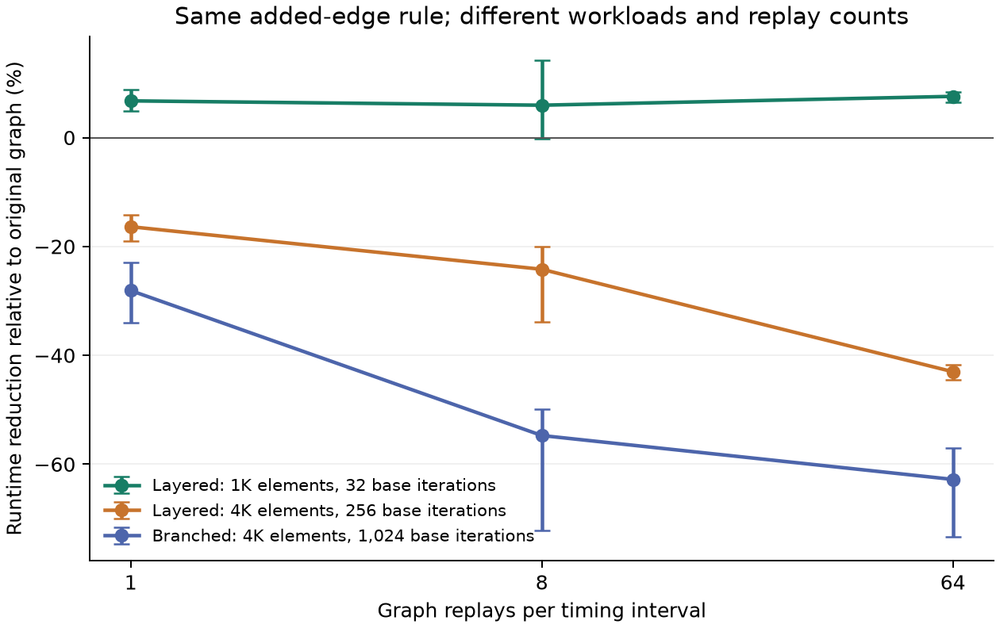

# A100 上 CUDA Graph 辅助依赖边优化的复现实验

## 1. 研究目标与复现范围

本实验参考 [Optimizing CUDA Graph Scheduling with Reinforcement Learning: A Case Study in SSTA Propagation](https://tsung-wei-huang.github.io/papers/2025-MLCAD.pdf)（MLCAD 2025），研究在保持计算内容不变时，向 CUDA Graph 添加辅助依赖边能否缩短执行时间，以及 ComposeDES 是否能够预测这种收益。原论文以 SSTA 为对象，通过 GNN 与 DQN 选择节点层级调整，并使用真实 GPU 执行时间提供反馈。

这里使用向量化的最大值传播计算，包含主机到设备的数据传输和具有分支汇合关系的计算节点。它保留了论文问题中的调度结构，但不是作者的 SSTA 算法，也不是完整大语言模型。GCN 与 DQN 是根据论文方法编写的简化实现，网络宽度、节点选择及图表示方式有所调整。因此本报告区分调度现象复现、预测方法验证与原算法精确复现。

**结论：已复现增加依赖边能够加速真实 CUDA Graph 的现象，但没有复现学习策略在留出图上稳定优于随机加边的结论。当前 ComposeDES 模型也没有形成稳定的选择优势。**

## 2. 实验环境与工作负载

- GPU：NVIDIA A100 PCIe 40GB，108 SM，未启用 MIG。驱动 595.71.05，CUDA Toolkit 13.0.88。
- Python 3.12，PyTorch 2.12.1+cu130，NumPy 2.4.6。CUDA 使用 `-O3 -std=c++17 -arch=sm_80`。
- ComposeDES 主仓库起点 `ac67442`；FNCS 子模块 `c71ce2c1dd9b270f87d9a7d41d0b5e31386d0810`。
- 每个传播节点对应一个 H2D 拷贝节点与一个 CUDA 计算节点。多数图包含 32 个传播节点，即 64 个 CUDA Graph 节点；另有一个 48 节点传播图，即 96 个 CUDA Graph 节点。
- 每个传播节点处理 1,024、4,096、16,384 或 65,536 个浮点元素。计算先合并前驱结果，再执行固定次数的 FMA；不同节点的 CTA 数和计算量不同。输入、CTA 数、循环次数、缓冲区地址在同一工作负载的候选间保持不变。
- 六个留出图使用独立随机种子 101–106，覆盖分层结构、多分支结构及随机 DAG。标定图种子为 11–14，强化学习训练图种子为 31、32。

向图添加依赖不减少计算量，也不改变最终结果。所有原始依赖均保留，只允许添加不会形成环的边。创建全部节点后再添加边，使辅助边实验的节点创建顺序保持相同。另设只改变创建顺序的对照。

## 3. 方法与基线

### 3.1 辅助依赖边

令原图为 G=(V,E)，候选图为 G'=(V,E∪E_aux)。节点调整采用保持当前层级、后移一层和后移两层三个动作。新增前驱从相应层级中选择，并排除目标节点本身及其后继。原图的合法结果因而得到保留。

这不意味着增加依赖能改进理论最优调度：加入约束后，可行调度集合只会缩小。测到的收益说明实际 CUDA Graph 调度在不同图结构下采用了不同的执行安排。它不能单独证明收益来自 SM、HBM 或调度器中的某一种具体机制。

对照包括原图、独立构建的相同原图、优先创建拷贝节点、优先创建计算节点，以及固定限制数据预取距离的规则。固定规则允许拷贝领先对应计算 1、2、4、8 个传播节点。例如距离 4 时，节点 g 的拷贝等待节点 g−4 的计算完成；32 个传播节点共添加 28 条边。这是节点距离，不是 Transformer 层数。

随机候选分别添加 1、2、4、8 条合法辅助边。与学习策略另设相同加边数量的随机候选。标定集选择出的固定规则为距离 8。全候选搜索使用进程 A 的测量选择，再用独立进程 B 评价，避免将 B 的最小值直接当作策略收益。没有声称有限候选构成理论最优。

### 3.2 ComposeDES

使用 ComposeDES 的 `WorkflowController` 维护 DAG 状态，由完成事件释放后继节点。GPU 执行模型将依赖就绪、资源准入及并发执行速率分开处理。模型包含最大并发计算数、计算干扰系数、节点提交间隔、拷贝与计算干扰系数，以及创建顺序与剩余路径优先级之间的权重。

第一版共有 72 组共享参数，使用四个标定图拟合权重。计算资源需求近似为 CTA 数除以 4 倍 SM 数，并限制在 1 以内；这不是对真实 SM 占用率的测量。H2D 使用一个串行服务资源。该模型只是可检验的近似，不能视为对 CUDA 调度器的精确还原。

目标输入为图结构、节点创建顺序及单节点独立运行时间；测试图的完整运行时间不参与参数拟合。除直接按预测选择外，还比较按预测分数选出八个候选，再用 A 的实测选择。参考数据包含全部预测成本：每个目标图枚举候选的 Python 仿真耗时约 26–80 秒，因此当前实现不能宣称在线低开销。

### 3.3 GCN 与 DQN

模型使用线程数、CTA 数、拷贝字节数、节点层级、入度和出度六类特征；两层图卷积生成表示，目标节点表示与全图平均表示拼接后输入动作网络。奖励为归一化执行时间的下降量。训练使用经验回放、目标网络、ε-greedy 探索、Huber 损失与 Adam；训练 100 轮，十轮后冻结图卷积参数。

六类输入没有显式编码本合成工作负载额外设置的 FMA 循环次数，因而不能完整区分计算强度。这限制了该简化策略的跨负载泛化；本轮负结果不能据此反驳原论文的 GCN+DQN 方法。

本轮训练执行了 527 次完整图计时评价，耗时约 15.8 秒。历史原始元数据将该计数写为 `unique_graph_evaluations`，实际含重复评价，应按总评价次数理解。所有训练开销与 ComposeDES 标定开销均属于离线成本。

## 4. 正确性与测量协议

每个候选都先将设备端输入与输出填成 NaN，再独立执行，并与 CPU 参考计算比较全部输出。所有已报告候选均通过检查。另有负向对照：强制根计算先于其 H2D 拷贝执行，检查器成功拒绝该错误依赖图。性能图内部没有计时事件，仅在整图回放前后计时。候选顺序、图实例构建顺序随机化，原始记录保留每轮位置。

第一阶段包含 604 个留出候选：进程 A 每候选 24 轮，进程 B 每候选 48 轮，每轮连续回放 8 次。这是每图平均 GPU 时间，不是服务端 TTFT 或 TPOT。第一次 A/A 比较在部分负载出现较大波动，所以没有直接接受全部表面收益。

第二阶段对冻结的代表候选各构建三个独立图实例，在新进程中做 32 个配对轮次，每次计时前预热 32 次、计时内回放 64 次。第三阶段对三个代表图固定图实例，在同一轮随机交错比较 1、8、64 次回放，每项 48 轮。后两阶段的区间同时重采样时间轮次和图实例。三种协议分别报告，不能把不同回放批量的数值当作同一种延迟指标。

尝试锁定 GPU 时钟被容器权限拒绝。保留了默认时钟设置并记录 GPU 状态；充分预热测试期间观察到 1410 MHz，但不据此声称所有观测都处于完全相同的硬件状态。

## 5. 实验结果

### 5.1 相同图实例上的回放次数敏感性

下表只比较固定距离 4 的加边规则，所有候选选择均已在前面的阶段冻结。正值表示比原图快，负值表示变慢。括号为分层 bootstrap 95% 区间，单位为百分比。

| 留出图 | 单次回放 | 连续 8 次 | 连续 64 次 |
|---|---:|---:|---:|
| layered-s101-n1024-r32 | +6.74% [4.89, 8.75] | +5.95% [-0.17, 14.27] | +7.57% [6.47, 8.44] |
| layered-s102-n4096-r256 | -16.37% [-19.06, -14.24] | -24.19% [-33.80, -20.06] | -43.01% [-44.44, -41.78] |
| fork-s103-n4096-r1024 | -28.11% [-34.00, -22.92] | -54.73% [-72.16, -49.81] | -62.79% [-73.32, -57.01] |

小任务图中，固定加边规则在单次与 64 次回放下均有明确收益，约为 6.7% 与 7.6%；8 次回放的点估计为 6.0%，但计入图实例差异后区间跨越零，证据较弱。另两个计算较重的图中，同一规则显著变慢。加边收益不能仅由边数或“减少并发”这一描述推断。



### 5.2 冻结策略的独立实例验证

下表为第二阶段的结果，每个逻辑候选有三个图实例、每次计时回放 64 次。表中“稀疏加边搜索”指在 A 中从至多添加八条边的候选里选择；“全部加边搜索”还允许固定距离规则。两者的选择均未使用本阶段时间。

| 图 | 原图 ms | 固定规则 | GCN+DQN | ComposeDES | ComposeDES＋8 次实测 | 稀疏加边搜索 | 全部加边搜索 |
|---|---:|---:|---:|---:|---:|---:|---:|
| 0 | 0.13648 | +1.37% | -1.13% | +0.32% | +0.34% | +1.94% | +7.68% |
| 1 | 0.21546 | +2.12% | +0.20% | -0.35% | +4.47% | +6.93% | -0.46% |
| 2 | 0.16040 | -24.20% | +0.00% | -21.18% | -21.18% | -21.14% | -24.20% |
| 3 | 0.32828 | -3.85% | +0.00% | +0.61% | +0.76% | +1.94% | +1.94% |
| 4 | 0.89106 | -3.44% | +0.00% | +0.83% | +1.03% | +1.66% | +1.66% |
| 5 | 0.25746 | +4.11% | +1.29% | +1.22% | +2.06% | -6.11% | -24.19% |

这些结果没有支持稳定的学习优势。GCN+DQN 在三个图上不添加边；这些情况直接视为保持原图，不把重复实例的时间差计入学习收益。ComposeDES 在所有六个图上都选了优先创建拷贝节点，说明本轮并未表现出有效的按图选择。在图 2 上，该选择退化约 21%，而在其他图上收益通常很小。

搜索结果也有明显迁移问题。图 1 中，至多八条边候选的选择在第二阶段改善约 6.9%，但在后续固定实例敏感性实验中未保持收益。因此该数字不能作为稳定加速的主结论。图 2 和图 5 的 A 中优胜方案在独立实例、长回放协议下均退化超过 20%。报告保留这些反例，不能只展示第一阶段的正收益。

### 5.3 Nsight 检查

独立 Nsight 运行确认原图与固定距离 4 的候选均执行 32 个计算 kernel、32 次 H2D 拷贝，总搬运量同为 131,072 字节。该 trace 没有用于训练或策略选择。

逐节点追踪使单图时间增加到约 0.4 ms，而未插桩测量约为 0.12–0.14 ms。因而当前 trace 只能核对工作量与顺序，不能用其中的重叠比例解释未插桩执行中数微秒的差值。尚未分离 SM 争用、拷贝服务及 CUDA Graph 提交/调度开销的因果贡献。

## 6. 可以与不可以得出的结论

1. 可以确认：保持原始计算与数据依赖，增加辅助依赖边能够改善 A100 上真实 CUDA Graph 的执行时间。收益在部分任务密集负载中有可重复证据。
2. 可以确认：固定加边规则并非普遍有效；工作负载与回放方式会影响其表现。完整功能 DAG 与独立节点耗时不足以使当前模型稳定选对。
3. 尚不能确认：少量加边、GCN+DQN 或 ComposeDES 能在未见图上稳定优于强固定规则和实测搜索。本实验的最稳健正例使用 28 条辅助边，不能据此宣称已经复现论文中少量边与学习策略的全部效果。
4. 尚不能确认：以上收益适用于真实 SSTA、完整推理模型或在线服务。原论文 GPU、计算 kernel、训练图和网络结构均与本实验不同。

后续应先固定目标执行方式，并把图级提交、任务释放与调度开销纳入可验证的模型，再在新的独立图上评价。当前数据适合作为模型开发与机制诊断集；已经分析过的六个图不能继续作为新模型的最终留出集。

## 7. 复跑与文件

在本分支根目录初始化子模块 `git submodule update --init fncs`。需要 CUDA 13、C++17、Python、NumPy 与带 CUDA 的 PyTorch。进入本目录后：

```bash
PYTHON=/root/miniconda3/bin/python NVCC=/usr/local/cuda/bin/nvcc bash run.sh
python confirm.py ../../runs/graph-edges
python sensitivity.py ../../runs/graph-edges
```

`run.sh` 重新标定、训练、冻结并运行独立验证；两条后续命令执行更严格的实例与回放次数检查。Nsight 路径使用 `trace.py` 与 `audit_trace.py`，必须保持与性能评价分离。

- [CUDA Graph 运行时](graph_runtime.cu)：显式图构建、仅首尾计时、NaN 污染及 CPU 数值检查。
- [候选生成与测量](experiment.py)、[冻结验证协议](validate.py)。
- [ComposeDES 模型](predict.py)、[GCN+DQN](learn.py)、[独立评价](analyze.py)。
- [独立实例检查](confirm.py)、[回放次数检查](sensitivity.py)。
- [第一阶段紧凑结果](reference/summary.json)、[独立实例结果](reference/confirmation.json)、[敏感性结果](reference/sensitivity.json)。
- [冻结参数](reference/frozen-des.json)、[学习参数](reference/gcn-dqn.pt)、[训练记录](reference/gcn-dqn.training.json)。

原始逐次测量与冻结候选已归档至 `experiments/megakernel_predictor/runs/graph-edges-data.tar.gz`，按仓库规则保留在本地；GitHub 保存代码、冻结模型和紧凑结果。归档 SHA256：`8fa78815bb1c7956a7dca70dc57dafdfd9fded8c344d732a651d6538c0f4b4e4`。服务器副本位于 `/root/autodl-tmp/ComposeDES/experiments/megakernel_predictor/runs/`。Nsight 原始报告及 SQLite 导出也已同步至本地 `runs/graph-edges/`。
