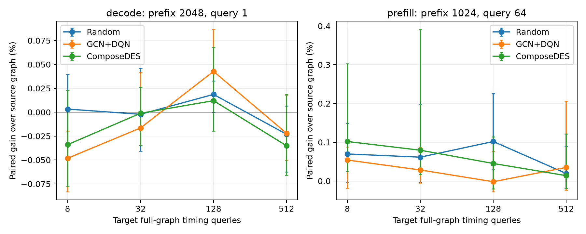

# 完整 Qwen3-8B 的 CUDA Graph 辅助边优化实验结果

本报告依据冻结方案后的独立测量生成。GPU 数值正确性按要求不作为实验前置条件；以下结果只描述该设备、软件版本和执行器上的性能，不证明模型输出正确，也不代表原生推理服务端性能。

## 1. 实际执行图与随机探索

完整模型包含 36 层、8,190,735,360 个参数。探索输入为 512-token GPU 驻留前缀和 1-token 前向。实际图含 2138 个节点，其中 1991 个 CUDA kernel，原始依赖 2494 条。Q/K/V 与 gate/up 的独立分支保留，候选仅添加辅助依赖。

共测量 10,000 个不同加边图，并额外测量 313 个穿插的原图对照。搜索中单次均值的最小值为 15.357952 ms，最大值为 19.982677 ms。它们是采样极值，不是理论上下界，也不是可复现收益。

| 冻结方案 | 独立复测中位时间（ms） | 配对收益（%） | 95% bootstrap 区间（%） |
|---|---:|---:|---|
| original | 15.375872 | +0.0000 | [+0.0000, +0.0000] |
| AA | 15.379285 | -0.0222 | [-0.0555, +0.0155] |
| best-0 | 15.378091 | +0.0033 | [-0.0355, +0.0388] |
| serial | 16.587435 | -7.8850 | [-7.8992, -7.8498] |

`best-0` 是搜索阶段选出的第一名；确认阶段不重新挑选主结果。串行对照用于衡量显式分支并行的作用，不将这部分收益归于 GCN+DQN 或辅助边。

## 2. 相同完整图实测预算

训练形状为 768/1，各方法 3,200 次查询；每个留出形状各 512 次查询。一次查询含 1 次预热、3 次计时回放。每方法训练共 12,800 次图执行，每个目标形状共 2,048 次。原图对照查询计入预算。独立确认测量不回流到选择器。

| 方法 | 训练查询 | 搜索与选择耗时（s） | 公共准备（s） | 其中独立节点标定（s） |
|---|---:|---:|---:|---:|
| 随机搜索 | 3200 | 311.69 | 24.72 | 0.189 |
| GCN+DQN | 3200 | 375.58 | 18.25 | 0.190 |
| ComposeDES | 3200 | 345.72 | 18.35 | 0.184 |

公共准备包括模型装载、参考路径执行、图捕获、独立节点标定和预热。各方法均执行公共准备；只有 ComposeDES 使用节点计时来预测。该成本另列，不隐藏为免费信息。搜索耗时包含模型计算、图构建、CPU 决策、训练和事件回放核对，不等于 GPU 算法推理开销。

## 3. 新形状和新进程上的冻结方案复测

训练后先固定策略与参数，再处理两个留出形状。所有最终候选在重建模型的新进程中、使用新 prompt 随机交错测量 32 轮，并核对源图节点、参数特征和依赖指纹相同。正收益表示快于同进程的原始分支图。配对收益定义为 median_r[100 × (T_original,r − T_candidate,r) / T_original,r]，因此不必等于两个边际中位时间的比值；区间通过重采样测量轮次获得。

| 前缀/新增 token | 方法与目标查询数 | 辅助边数 | 中位时间（ms） | 配对收益（%） | 95% bootstrap 区间（%） |
|---|---|---:|---:|---:|---|
| 2048/1 | original | 0 | 15.557803 | +0.0000 | [+0.0000, +0.0000] |
| 2048/1 | AA | 0 | 15.561557 | +0.0022 | [-0.0515, +0.0405] |
| 2048/1 | serial | — | 16.742571 | -7.6498 | [-7.6634, -7.6223] |
| 2048/1 | random-512 | 6 | 15.559339 | -0.0230 | [-0.0626, +0.0066] |
| 2048/1 | dqn-512 | 0 | 15.556437 | -0.0220 | [-0.0503, +0.0175] |
| 2048/1 | des-512 | 0 | 15.560362 | -0.0351 | [-0.0659, +0.0186] |
| 2048/1 | dqn-zero | 12 | 15.605077 | -0.3133 | [-0.3313, -0.2929] |
| 2048/1 | des-zero | 5 | 15.575893 | -0.1306 | [-0.1679, -0.0977] |
| 1024/64 | original | 0 | 18.574165 | +0.0000 | [+0.0000, +0.0000] |
| 1024/64 | AA | 0 | 18.547371 | +0.0395 | [-0.0404, +0.1378] |
| 1024/64 | serial | — | 19.882154 | -7.0281 | [-7.1143, -6.9424] |
| 1024/64 | random-512 | 4 | 18.566315 | +0.0193 | [-0.0193, +0.0900] |
| 1024/64 | dqn-512 | 2 | 18.555563 | +0.0351 | [-0.0239, +0.2060] |
| 1024/64 | des-512 | 0 | 18.556416 | +0.0138 | [-0.0193, +0.1211] |
| 1024/64 | dqn-zero | 3 | 18.562559 | +0.0543 | [-0.0404, +0.1194] |
| 1024/64 | des-zero | 2 | 18.534401 | +0.0505 | [-0.0221, +0.2227] |

`zero` 表示无目标完整图计时反馈的冻结策略。ComposeDES 仍使用目标独立 kernel 标定，不能称为完全零标定。GCN+DQN 的目标权重不更新，预算内以 epsilon=0.05 探索；ComposeDES 按相同预算更新共享参数权重。辅助边数为 0 的选择与原图依赖相同，其计时差异不能归因于加边优化。

预算曲线按 8/32/128/512 次目标查询的冻结选择绘制；误差条是同一确认进程内配对中位收益的 bootstrap 区间，不包含多随机训练种子或多 GPU 的不确定性。

## 4. 完整 32-token 生成

以下测量执行首个完整前向和后续 31 个自回归前向。仅首个前向使用选中图，后续 decode 路径一致。TTFT 从提交首个前向到 CPU 取得首 token，包含同步和取回 token；不含 tokenizer、前缀构建、图捕获或服务队列。TPOT 为同一请求中后续 token 间隔的中位数，再对 8 次生成取中位数。

| 前缀/新增 token | 方案 | TTFT（ms） | TPOT（ms） | 总时间（ms） | 输出吞吐（token/s） |
|---|---|---:|---:|---:|---:|
| 2048/1 | des-512 | 15.663 | 16.846 | 538.405 | 59.43 |
| 2048/1 | dqn-512 | 15.732 | 16.852 | 538.739 | 59.40 |
| 2048/1 | original | 15.674 | 16.850 | 538.495 | 59.42 |
| 2048/1 | random-512 | 15.689 | 16.850 | 538.433 | 59.43 |
| 2048/1 | serial | 16.864 | 16.848 | 539.864 | 59.27 |
| 1024/64 | des-512 | 18.329 | 16.763 | 538.868 | 59.38 |
| 1024/64 | dqn-512 | 18.330 | 16.765 | 538.809 | 59.39 |
| 1024/64 | original | 18.320 | 16.765 | 538.983 | 59.37 |
| 1024/64 | random-512 | 18.308 | 16.764 | 538.813 | 59.39 |
| 1024/64 | serial | 19.668 | 16.761 | 540.122 | 59.25 |

## 5. 结论适用范围

本轮复现的是论文公开的节点层级动作、两跳 GCN、DQN 训练机制及已给出的超参数；应用从 SSTA 换为完整 Qwen3-8B。论文未完整给出的实现细节和本轮的预算扩展列于 README 与 PROTOCOL.json，不能表述为作者原代码的逐项复现。

该实验只有一个训练随机种子、两个留出输入形状和一台存在已知显存异常的 A100；固定 kernel 图的性能测量不能证明其他负载、并发批次、GPU 或原生服务框架也有相同结果。两个留出形状仍来自相同 Transformer 结构，不构成跨应用依赖拓扑泛化证据。没有进行数值正确性筛选。若性能差异与 A/A 波动相近或区间包含零，应报告未观察到稳定收益。

ComposeDES 在本轮使用独立节点计时和有限共享参数的资源模型。编译后的事件循环负责大批候选预测，ComposeDES WorkflowController 核对所选图的依赖回放。资源模型只是近似，不应将它的结果推广为所有 ComposeDES 模型的能力上限。
